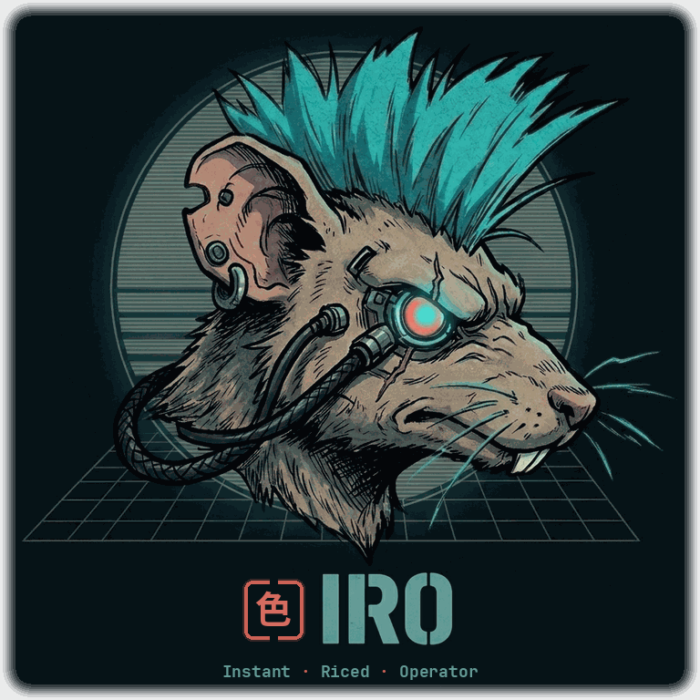

<div align="center">



# iro

**Instant · Riced · Operator**

*Ein Terminal-Editor ohne Modi, der gut aussieht, nicht im Weg steht und nie deine Arbeit verliert.*


[English](README.md) · **Deutsch**

</div>

<!-- TODO: Demo-GIF kommt hierher -->

> **Frühe Alpha.** iro ist jung, entwickelt sich schnell und läuft bisher täglich
> auf genau einem Arch-Laptop. Es gibt eine Testsuite, aber noch keine lange
> Bewährung. Für Configs, die dich aus dem eigenen Rechner aussperren können,
> halte deinen alten Editor griffbereit, bis iro dein Vertrauen verdient hat.

## Was ist iro?

iro ist ein Terminal-Editor für alle, die **die Einfachheit von micro** mit dem
**Komfort eines modernen GUI-Editors** wollen und denen nicht egal ist, wie ihr
Terminal aussieht.

Datei öffnen, lostippen. Keine Modi zum Auswendiglernen, kein Plugin-Manager,
der gefüttert werden will. Strg+S speichert, Strg+Q beendet, die Maus funktioniert
einfach, und alles andere ist eine Taste oder ein Menü entfernt.

*Der Name:* **色** (*iro*) ist japanisch für „Farbe, Stil“, ein passendes Wort für
einen Editor zum Ricen.

### Was iro nicht ist

iro will weder Neovim noch Helix oder Emacs ersetzen. Wer in einem liebevoll
getunten modalen Setup mit vierzig Plugins lebt: behalten, das ist verdient.
iro zielt auf die Lücke zwischen *„nano, aber traurig“* und *„ich konfiguriere
meinen Editor, statt ihn zu benutzen“*.

## Warum iro?

### ⚙️ Zwei Gears, dieselben Tasten

Die meiste Arbeit im Editor ist eine von zwei Sorten, deshalb hat iro zwei Gänge:

| | Gear | Motto | Was du bekommst |
|---|---|---|---|
| ✂️ | **Blade** | *Get in. Cut. Get out.* | **Config-Modus: einfach und schnell.** Nur der Text, im Hintergrund läuft nichts. Ideal für eine schnelle Korrektur an `hyprland.lua` oder `/etc/fstab`. |
| ⚒️ | **Forge** | *Heat up. Hammer. Ship it.* | Dateibaum, Minimap, Git-Spalte, projektweite Dateisuche. Zum richtigen Programmieren. |

iro **wählt den Gang selbst**: Öffnest du eine Datei, landest du in Blade;
öffnest du einen Ordner (oder gar nichts), landest du in Forge. Alt+G wechselt
jederzeit, und die Tasten bleiben in beiden Gängen gleich.

### 🎨 Von Haus aus gericed, ruhig, wenn es drauf ankommt

- **Folgt deinem Wallpaper.** iro liest die Palette des Terminals. Färbt dein
  Wallpaper-Werkzeug das Terminal um, färbt sich iro mit. Live.
- **16 fertige Farbsätze** für alle, die es fest mögen, darunter zwei Retro-Sätze
  (grüner Phosphor- und Bernstein-Röhrenmonitor).
- Cursorzeile, Git-Spalte, Einrückhilfen, Klammer-Paare, eine **Braille-Minimap**,
  kleine weiche Animationen und Nerd-Font-Symbole.
- **kitty-nativ.** Logo auf der Startseite, jede Tastenkombination. Andere Terminals
  bekommen die schlichte Fassung.
- **Leerlauf heißt Leerlauf.** Kein Neuzeichnen, keine Dauerschleife, nur alle zehn
  Sekunden ein Wallpaper-Sync.
- Alles einzeln abschaltbar. Geschmackvoll ist das Ziel, nicht Kirmes.

### 🛟 Paranoid, wenn es um deine Daten geht

- **Atomares Speichern:** erst in eine Zwischendatei schreiben, synchronisieren,
  dann umbenennen. Ein Absturz mitten im Speichern lässt die alte Datei heil.
  Rechte, Besitzer und Gruppe, ACLs und Symlinks bleiben erhalten. Dateien mit
  Hardlinks schreibt iro direkt, damit die Links halten.
- **Wiederherstellung nach Absturz:** Ungespeichertes, auch in Tabs ohne
  Dateinamen, wird binnen zwei Sekunden gesichert und nach einem Absturz oder einem
  geschlossenen Terminal wieder angeboten.
- **Frühere Versionen:** Vor jedem Speichern wandert der alte Stand in einen lokalen
  Verlauf, die letzten 20 pro Datei. Alt+R holt einen zurück. Geheimnisse bekommen
  keine Kopien.
- **Auf der Platte geändert?** iro sagt Bescheid, bevor es fremde Änderungen
  überschreibt.
- **Doppelt offen?** Das zweite iro liest nur mit, keins überschreibt das andere.
  Kein Fehlalarm nach einem Absturz.
- „Speichern unter“ ersetzt nie stillschweigend eine vorhandene Datei.

### 🔒 Sicher gebaut

- **Erkennt „Trojan Source“:** Unsichtbare Zeichen, die die Leserichtung umdrehen
  oder Text verstecken, erscheinen als rote Marke.
- Steuerzeichen in Dateinamen und Inhalten erreichen dein Terminal nie roh.
- Die Lua-Config läuft **an der Leine**: Sie darf rechnen und Umgebungsvariablen
  lesen, aber keine Programme starten, keine Dateien anfassen und keinen Code
  nachladen. Gelesen wird sie nur aus iros eigenem Config-Ordner, nie aus einem
  Projekt, das du gerade geklont hast.
- Immer im sicheren Modus von Zig gebaut, mit eingeschalteten Laufzeitprüfungen.

### ⚡ Klein und schnell

- **Rund 2 MB** Programmgröße (gestrippt, Logo inklusive). Zur Laufzeit nötig:
  libc und Lua.
- **Rund 7 MB RAM** mit einer offenen Quelldatei von 4000 Zeilen.
- **Dateisuche über ~350 000 Dateien in 40–75 ms** (warmer Cache), im Hintergrund
  auf allen Kernen eingelesen, mit Tippfehler-Toleranz. `hyprlnad` findet
  trotzdem `hyprland.lua`.

### 🔋 Alles dabei, keine Plugins

iro hat bewusst **kein Plugin-System und keine Erweiterungen**. Was es kann, kann es
ab Werk, und alles wird gemeinsam ausgeliefert, getestet und repariert. Der
Vorteil: nichts zu installieren, nichts zu aktualisieren, keine Config-Archäologie
nach einem Jahr Pause.

## Funktionen im Überblick

- **Bearbeiten:** Undo/Redo wortweise, Suchen und Ersetzen, Wort-Vervollständigung,
  weicher Zeilenumbruch, Kommentar ein/aus, Ein-/Ausrücken, Zeilen verdoppeln und
  verschieben, mehrere Tabs, geteilte Ansicht.
- **Navigation:** klickbarer Dateibaum mit Anlegen/Umbenennen/Papierkorb,
  Befehlspalette mit unscharfer Suche, projektbezogene Dateisuche (Strg+O,
  nochmal drücken für das ganze Home), Ordnersprung per zoxide.
- **Syntax-Farben für 28 Sprachen,** von Shell, Hyprland- und kitty-Configs bis
  Zig, Rust, C/C++, Python, Go, JS/TS, Lua, Nix und Markdown.
- **Einstellungsseite zum Anklicken** (Esc → Einstellungen) mit Live-Vorschau der
  Farbsätze, oder schlichtes Lua in der `init.lua`, wenn dir Text lieber ist.
- **Eingebaute Hilfe** (Alt+H) und eine Hinweisleiste mit den Tasten, die gerade
  zählen.
- **Oberfläche auf Deutsch und Englisch,** folgt der Systemsprache.

## Installation

Gebraucht werden **Zig 0.17.x** (bewusst festgenagelt) und **Lua 5.4**.

```sh
git clone https://github.com/mantantis/iro.git
cd iro
zig build --prefix ~/.local    # installiert ~/.local/bin/iro
```

Unter Arch gibt es auch ein `PKGBUILD`: `makepkg -si`.

Optional zur Laufzeit: `wl-clipboard` (Wayland-Zwischenablage), `glib2`
(Papierkorb), `zoxide` (Alt+Z), `git` (Git-Spalte), eine Nerd-Schrift (Symbole).

## Tasten

| Taste | Wirkung |
|---|---|
| Strg+S / F12 | speichern / speichern unter |
| Alt+R | frühere Versionen dieser Datei |
| Strg+O / Strg+P / Alt+Z | Datei suchen / Befehlspalette / Ordner aus zoxide |
| Strg+B | Dateibaum (darin: N neue Datei, O neuer Ordner, F2 umbenennen, Entf Papierkorb) |
| Strg+F / F3 / Strg+R | suchen / weitersuchen / suchen und ersetzen |
| Strg+K / Strg+D | Kommentar ein/aus / Zeile verdoppeln |
| Alt+Hoch / Alt+Runter | Zeile verschieben |
| Strg+Z / Strg+Y | rückgängig / wiederholen |
| Strg+Leer | Wort vervollständigen |
| Alt+G | Gear wechseln: Blade ⇄ Forge |
| Alt+W / Alt+V | weicher Zeilenumbruch / Ansicht teilen |
| Strg+N / Strg+W / Alt+1…9 | neuer Tab / Tab schließen / Tab direkt anspringen |
| Esc / F10 | Hauptmenü |
| Alt+H | Hilfe: jede Taste und jedes Zeichen erklärt |
| F9 | Über iro (schau zu, wie es sich entschlüsselt) |

Jede Taste lässt sich umbelegen.

## Einstellungen

```lua
-- ~/.config/iro/init.lua
gear = "auto"               -- "blade", "forge" oder "auto"
theme = "terminal"          -- folgt der Terminal-Palette, oder z. B. "nord", "phosphor"
tab_width = 4
minimap = true
keys = { tree = "Strg+E", replace = "Strg+H" }
colors = { accent = "#00E5FF" }
```

Noch keine `init.lua`? Strg+P → „Einstellungen öffnen (init.lua)“ legt eine
kommentierte an. Änderungen gelten beim Speichern.

## Roadmap

- **Config-Fallschirm:** Bevor eine System-Config gespeichert wird, prüft iro sie
  mit dem Werkzeug, das sich damit am besten auskennt (`visudo -c`, `sshd -t`,
  `findmnt --verify`, `hyprctl configerrors` und Co.), und kann eine riskante
  Änderung automatisch zurückrollen, wenn du sie nicht bestätigst. Denn niemand
  sollte einen Live-USB-Stick brauchen, um einen Tippfehler zu reparieren.
- **Ein komfortableres Forge:** Suche in Dateiinhalten und mehr von dem, was man
  braucht, um den ganzen Tag im Terminal zu programmieren.

**Was neu ist:** steht in der [CHANGELOG.md](CHANGELOG.md) (auf Englisch).

## Bauen und testen

```sh
zig build                      # baut zig-out/bin/iro
zig build test                 # Kerntests
tests/e2e.sh                   # Probelauf in tmux (~4 Minuten)
```

## Credits

Idee & Design: **Mausmann**. Gebaut mit KI (Claude Code & Antigravity).
Terminal-Darstellung mit [libvaxis](https://github.com/rockorager/libvaxis).

## Lizenz

`Copyright (C) 2026 Mausmann` · [GNU GPL v3.0 oder neuer](LICENSE), mit
Zusatzbedingungen nach § 7 (siehe [`NOTICE.md`](NOTICE.md#deutsch)).

Forken, hacken, ricen: ausdrücklich erwünscht. Gib deiner Fassung nur einen
eigenen Namen, lass die Credits stehen und schreib „Based on iro by Mausmann“
dazu. Ehre, wem Ehre gebührt.
