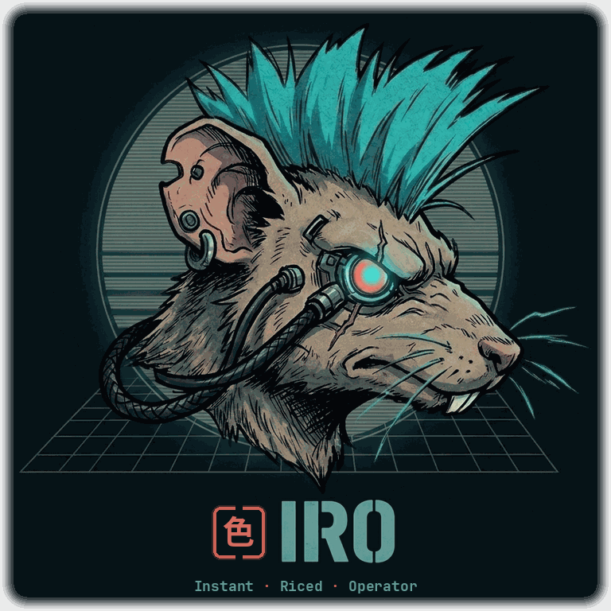

<div align="center">



# iro

**Instant · Riced · Operator**

*A modeless terminal editor that looks good, stays out of your way and never loses your work.*


[](https://github.com/mantantis/iro/actions/workflows/ci.yml)


**English** · [Deutsch](README.de.md)

</div>

<!-- TODO: demo GIF goes here -->

> **Early alpha.** iro is young, moves fast and is used daily on exactly one Arch
> laptop so far. It has a test suite, but no track record yet. For configs that
> can lock you out of your own machine, keep your old editor within reach until
> iro has earned your trust.

## What is iro?

iro is a terminal editor for people who want **micro's simplicity** with the
**comfort of a modern GUI editor**, and who care how their terminal looks.

You open a file and type. There are no modes to learn and no plugin manager to
feed. Ctrl+S saves, Ctrl+Q quits, the mouse just works, and everything else is
one keystroke or one menu away.

*The name:* **色** (*iro*) is Japanese for “colour, style”, a fitting word for a riced editor.

### What iro is not

iro is not trying to replace Neovim, Helix or Emacs. If you live inside a
carefully tuned modal setup with forty plugins, keep it. You have earned it.
iro aims at the space between *“nano, but I'm sad”* and *“I'm configuring my
editor instead of using it.”*

## Why iro?

### ⚙️ Two gears, same keys

Most editing is one of two jobs, so iro has two gears:

| | Gear | Motto | What you get |
|---|---|---|---|
| ✂️ | **Blade** | *Get in. Cut. Get out.* | **Config edit mode: simple and fast.** Just the text, nothing running in the background. Perfect for a quick fix to `hyprland.lua` or `/etc/fstab`. |
| ⚒️ | **Forge** | *Heat up. Hammer. Ship it.* | File tree, minimap, git gutter, project-wide file search. For actually writing code. |

iro **picks the gear for you**: open a file and you land in Blade, open a folder
(or nothing at all) and you land in Forge. Ask for the file tree, a second tab,
split view or file search while in Blade and iro shifts up to Forge on its own.
Alt+G switches at any time, and the keys never change between gears.

### 🎨 Riced by default, quiet when it matters

- **Follows your wallpaper.** iro reads the terminal's own palette, so when your
  wallpaper tool recolours the terminal, iro recolours with it. Live.
- **16 built-in themes** if you prefer a fixed look, including two retro ones
  (green phosphor and amber CRT).
- Cursor line, git gutter, indent guides, bracket pairs, a **Braille minimap**,
  smooth little animations and Nerd Font icons.
- **kitty native.** Logo on the start screen, every key combo. Other terminals get
  the plain cut.
- **Idle means idle.** No redraws, no busy loops, just a wallpaper sync every
  ten seconds.
- Everything can be switched off individually. Tasteful is the point, not a
  fairground.

### 🛟 Paranoid about your data

- **Config Guard:** before saving known system and dotfile configs (`fstab`,
  `sudoers`, `sshd_config`, `systemd` units, shell scripts, JSON), iro checks
  the draft with the matching tool (`findmnt --verify`, `visudo -cf`, `sshd -t`,
  `systemd-analyze verify`, `bash -n`/`sh -n`, built-in JSON) and warns before
  writing broken syntax. Hyprland configs are checked with `hyprctl configerrors`
  right after saving.
- **Atomic saves:** write to a temporary file, sync, then rename. A crash mid-save
  leaves the old file intact. Permissions, owner and group, ACLs and symlinks
  survive. Hard-linked files are written in place, so their links hold.
- **Crash recovery:** unsaved work, even in tabs without a file name, is backed
  up within two seconds and offered back after a crash or a closed terminal.
- **Earlier versions:** before every save, the old state goes into a local history,
  the last 20 per file. Alt+R brings one back. Secrets get no copies.
- **Changed on disk?** Come back to iro and untouched tabs are already up to date.
  With unsaved work, iro warns you and lets you pick: overwrite, or load the disk
  version.
- **Open twice?** The second iro only reads along, so neither overwrites the other.
  No stale-lock nagging after a crash.
- “Save as” never silently replaces an existing file.

### 🔒 Secure by design

- **Trojan Source detection:** invisible characters that flip the reading
  direction or hide text are shown as red markers.
- Control characters in file names and contents never reach your terminal raw.
- The Lua config runs **on a leash**: it can compute and read environment
  variables, but cannot start programs, touch files or load code. It is only ever
  read from iro's own config folder, never from a project you just cloned.
- Always built in Zig's safe mode, with runtime checks left on.

### ⚡ Small and fast

- **About 2 MB** stripped binary, logo included. Runtime dependencies: libc and Lua.
- **About 7 MB of RAM** with a 4,000-line source file open.
- **File search across ~350,000 files in 40–75 ms** (warm cache), indexed in the
  background on all cores, with typo tolerance. `hyprlnad` still finds `hyprland.lua`.

### 🔋 Batteries included, no plugins

iro deliberately has **no plugin system and no extensions**. What it does, it does
out of the box, and it all ships, gets tested and breaks together. The upside:
nothing to install, nothing to update, no config archaeology after a year away.

## Features at a glance

- **Editing:** word-wise undo/redo, find and replace, word completion, soft wrap,
  toggle comment, indent/outdent, duplicate and move lines, multiple tabs, split view.
- **Navigation:** clickable file tree with create/rename/trash, command palette with
  fuzzy search, project-aware file search (Ctrl+O, press again for your whole
  home), folder jumps via zoxide.
- **Syntax colours for 28 languages,** from Shell, Hyprland and kitty configs to
  Zig, Rust, C/C++, Python, Go, JS/TS, Lua, Nix and Markdown.
- **Point-and-click settings page** (Esc → Settings) with live theme preview, or
  plain Lua in `init.lua` if you prefer text.
- **Built-in help** (Alt+H) and a hint bar that shows the keys that matter right now.
- **English and German UI,** following your system language.

## Installation

You need **Zig 0.17.x** (pinned on purpose) and **Lua 5.4**.

```sh
git clone https://github.com/mantantis/iro.git
cd iro
zig build --prefix ~/.local    # installs ~/.local/bin/iro
```

On Arch there is also a `PKGBUILD`: `makepkg -si`.

Optional at runtime: `wl-clipboard` (Wayland clipboard), `glib2` (trash),
`zoxide` (Alt+Z), `git` (git gutter), a Nerd Font (icons).

For root-owned system configs, use `SUDO_EDITOR=iro sudoedit /etc/fstab` instead
of `sudo iro` — your config and theme stay intact and iro never runs as root.

## Keys

| Key | Action |
|---|---|
| Ctrl+S / F12 | save / save as |
| Alt+R | earlier versions of this file |
| Ctrl+O / Ctrl+P / Alt+Z | find file / command palette / folder from zoxide |
| Ctrl+B | file tree (inside: N new file, O new folder, F2 rename, Del trash) |
| Ctrl+F / F3 / Ctrl+R | find / find next / find and replace |
| Ctrl+K / Ctrl+D | toggle comment / duplicate line |
| Alt+Up / Alt+Down | move line |
| Ctrl+Z / Ctrl+Y | undo / redo |
| Ctrl+Space | complete word |
| Alt+G | switch gear: Blade ⇄ Forge |
| Alt+W / Alt+V | soft wrap / split view |
| Ctrl+N / Ctrl+W / Alt+1…9 | new tab / close tab / jump to tab |
| Esc / F10 | main menu |
| Alt+H | help: every key and symbol explained |
| F9 | about iro (watch it decrypt itself) |

Every key can be remapped.

## Configuration

```lua
-- ~/.config/iro/init.lua
gear = "auto"               -- "blade", "forge" or "auto"
theme = "terminal"          -- follow the terminal palette, or e.g. "nord", "phosphor"
tab_width = 4
minimap = true
keys = { tree = "Ctrl+E", replace = "Ctrl+H" }
colors = { accent = "#00E5FF" }
```

No `init.lua` yet? Ctrl+P → “Open settings file (init.lua)” creates a commented one.
Changes apply on save.

## Roadmap

- **Config Guard v2:** automatic dead-man's switch that rolls a risky system
  config back if you don't confirm it in time, plus atomic sudo saving.
- **A more comfortable Forge:** search across file contents and more of what you
  need to code all day without leaving the terminal.

**What's new:** see [CHANGELOG.md](CHANGELOG.md).

## Building and testing

```sh
zig build                      # build zig-out/bin/iro
zig build test                 # unit tests
tests/e2e.sh                   # end-to-end run in tmux (~4 minutes)
```

## Credits

Idea & design: **Mausmann**. Built with AI (Claude Code & Antigravity).
Terminal rendering by [libvaxis](https://github.com/rockorager/libvaxis).

Like iro? Tips go straight into coffee and AI tokens:

<a href="https://ko-fi.com/mausmann" title="Support me on Ko-fi"></a>

## License

`Copyright (C) 2026 Mausmann` · [GNU GPL v3.0 or later](LICENSE), with additional
terms under section 7 (see [`NOTICE.md`](NOTICE.md)).

Free as in freedom: read it, bend it, share it. Forks get their own name, keep
the credits and tip their hat to the original: “Based on iro by Mausmann”.
